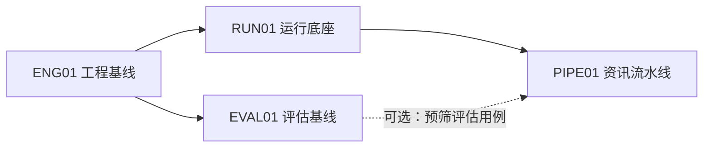

# AI 自动化路线图：阶段 0 与阶段 1（2026-11-14）

## 当前进度（2026-11-16）

ENG01、RUN01、EVAL01均已完成。EVAL01工程提交4bb8873的真实Windows Node22/24各904项通过，正式replay8/8、事实21/21；见[EVAL01独立验收](../reports/EVAL01-20261115-review.md)。PIPE01于2026-11-16获授权并完成，工程提交c090077的Windows Node22/24 CI通过；见[PIPE01独验](../reports/PIPE01-20261116-review.md)。正式Windows自启仍未安装，当前用户工作台未重启加载新版本。本批完成停止，阶段2未授权。

## 用户决定（2026-11-14 冻结）

| 问题 | 用户决定 | 对任务卡的约束 |
|---|---|---|
| 自动化范围 | 产品运行自动化与开发流程自动化**两者都要** | 阶段 0 同时补工程地基（ENG01、EVAL01）与产品运行地基（RUN01）。 |
| 人工确认 | **仍由用户确认** | 自动化只能抓取、预筛、排队、提示；Raw 创建、整理发起须由用户确认候选后执行；正式 Wiki/Prompt 写入沿用既有人工审核。 |
| 预算 | **暂不设上限，先跑通链路** | 不实现硬性额度拦截，但每次自动运行必须记录请求数/token/未知用量；保留全局暂停开关。验收真实调用不设上限，仍须如实记账，失败不得盲目重试。 |
| 运行方式 | **接受后台常驻** | RUN01 提供生产启动模式、Windows 登录自启、单实例锁和进程内调度器。 |

上述决定只改变本路线图涉及的批次。Raw 不由 AI 改写、AI 输出只进草稿、会议新来源禁止进入 AI/Wiki/Prompt、产品运行独立于 Codex/Agent CLI/Obsidian 等既有不变量继续有效。

## 批次与依赖

| 阶段 | 任务卡 | 目标 | 暂定评分/模式 | 依赖 |
|---|---|---|---|---|
| 0 | [ENG01 工程基线与开发自动化地基](../handoffs/ENG01-20261114-task.md) | 全仓类型检查与测试全绿、GitHub Actions CI、文档上下文瘦身、工作区清点 | 0/1/1/1=3，A 标准（Sol 先审计划） | 无 |
| 0 | [RUN01 后台常驻与自动化运行底座](../handoffs/RUN01-20261114-task.md) | 生产启动、Windows 自启、单实例锁、调度器、运行账本、用量计量、自动化页面 | 1/2/2/0=5，B | ENG01 PASS |
| 0 | [EVAL01 AI 质量评估基线](../handoffs/EVAL01-20261114-task.md) | 可离线回放的评估集与评分器，CI 跑回放模式 | 1/1/0/1=3，A 标准（Sol 先审计划） | ENG01 PASS；可与 RUN01 并行，不阻塞 PIPE01 |
| 1 | [PIPE01 资讯→Raw→知识草稿自动流水线](../handoffs/PIPE01-20261114-task.md) | 定时抓取→AI 预筛→候选收件箱→用户确认→Raw+自动整理→首页待审 | 1/2/2/1=6，B | RUN01 PASS |

每批独立验收 PASS 是进入依赖批次的必要条件，但不构成下一批施工授权。用户于 2026-11-15 先授权ENG01、确认其完成后再授权RUN01；其后明确授权EVAL01并完成。三批现已完成。后续仍遵守：每批完成后汇报并停止，等待用户明确确认后才启动下一批，不自动推进或跨批并行。阶段 2（知识维护巡检、事项提醒）与阶段 3（外部来源接入、低风险免审）不在本授权内。

## 交给 Codex 的执行方式

施工通过 [agent-router](../../.agents/skills/agent-router/SKILL.md) 的“已授权执行闭环”进行：

1. Codex 主线程作为协调者，先读 `AGENTS.md`、`docs/status.md` 顶部条目、本路线图及当前任务卡；不重读全量历史。
2. 按卡内评分选择模式与角色（模型映射见 [roles.md](../../.agents/skills/agent-router/references/roles.md)）。规划者可在不改变目标/必做/验收项的前提下细化接口，并把细化写回任务卡“规划补充”节后冻结。
3. 施工者与最终验收者必须是不同实例；验收者独立复现，不仅凭施工报告签收。
4. 每批交付：施工报告 `docs/reports/<ID>-<日期>-builder.md`、独立验收报告 `docs/reports/<ID>-<日期>-review.md`、`docs/status.md` 顶部新条目；主线程按 AGENTS.md 提交并推送，只提交本批文件。
5. 遇到卡内“需用户决定”事项、超出范围或同核心缺陷修后再失败，暂停并向用户汇报。

后续经用户明确选择批次后，可使用以下启动指令（模板本身不构成授权）：

> 使用 agent-router 执行入口，仅施工用户明确批准的当前批次。按任务卡完成规划、施工、独立验收、必要返修和提交推送，并验证真实 CI。每批完成后汇报并停止，等待用户明确确认后才启动下一批；不自动推进或跨批并行。遇到超范围问题先向用户汇报。

## 共同约束（所有四卡适用）

- 开发与施工自测只用隔离数据根（`FMCG_DATA_DIR` 指向 TEMP）和本地 fake；不读写正式 `workspace/`、不读取或输出 `.env.local` 密钥内容；真实 Provider 调用只在卡内明确的真实验收步骤，用隔离数据根执行并记账。
- 不停止、不重启用户正在运行的服务（当前已知 API 5151 / UI 5173）；自测服务使用其他端口，结束后关闭。
- 当前工作区存在其他任务的未提交修改（`AGENTS.md`、RAWZH01 报告、`tests/acceptance/rawzh01-builder-browser.mjs`、7 个已删除的 AUTO01 证据文件及大量未跟踪证据）。不覆盖、不回退、不纳入本批提交，除非 ENG01 经用户确认的清点方案明确处理。
- 历史验收结论不改写；新结论只写新条目。
- 本路线图由 Antigravity 主 Agent 规划，未派发施工，未进行任何产品修改或真实模型调用。
