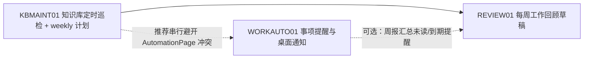

# AI 自动化路线图：阶段 2 知识库巡检与事项跟进（2026-11-20）

承接 [阶段 0 与阶段 1 路线图](AUTO-ROADMAP-20261114.md)（ENG01、RUN01、EVAL01、PIPE01 均已 PASS，且 LINT01–02、KBI01、QAUI02–03、UIFIX01–04、NEWS11–18 已交付）。阶段 2 的目标是让后台常驻工作台从“每日资讯输入”扩展到**知识库定期自检、工作事项主动提醒、每周回顾自动起草**。

## 延续的冻结原则（沿用 2026-11-14 用户决定与项目不变量）

1. **人工确认边界不变**：自动化只巡检、提醒、起草；绝不自动修改正式 Wiki、绝不自动创建/修改 Raw 或 Prompt、绝不自动改变工作事项状态或替用户外发消息、绝不未经预览就发起产品事项 AI 分析。
2. **后台常驻、不设硬预算但全程记账**：所有定时任务运行在 RUN01 调度器内，继续复用 `AutomationContext` 的用量计量（requests / inputTokens / outputTokens / unknownUsageCount）与全局“暂停全部自动化”开关。
3. **会议来源与隐私门禁不变**：`meeting_local_only` 及受限会议来源禁止进入任何自动巡检或周报 AI 输入；Windows 桌面通知仅展示标题与提醒类型，不暴露正文、客户沟通细节或密钥。
4. **逐批明确授权**：本路线图和三张任务卡构成规划产出，**本身不构成施工授权**。用户逐批确认后再交 Codex 按 `agent-router` 施工，每批独立验收且远程 CI PASS 后汇报并停止。阶段 3（WORK05 外部来源接入、低风险免审讨论）不在本路线图内。

## 批次与依赖

| 顺序 | 任务卡 | 核心目标 | 暂定评分/模式 | 依赖 |
|---|---|---|---|---|
| 1 | [KBMAINT01 知识库定时巡检与周计划扩展](../handoffs/KBMAINT01-20261120-task.md) | 调度器新增 `weekly` 计划；接入定时结构检查（`wiki.lint`，含增量 diff）与定时主动知识检查（`wiki.inspect`，只产待核发现不自动改库） | 1/2/2/0=5，B | 阶段 0–1、LINT01–02、KBI01（均已 PASS） |
| 2 | [WORKAUTO01 事项到期提醒、桌面通知与新资料提示](../handoffs/WORKAUTO01-20261120-task.md) | 定时扫描到期/久未推进事项与产品事项未分析新 Raw；站内去重提醒中心 + 可选 Windows Toast 桌面通知（含免打扰时段），零模型调用 | 1/2/1/0=4，A 标准（Sol 先审计划） | RUN01、WORK01–04（建议在 KBMAINT01 后串行，避开共享 UI/API 冲突） |
| 3 | [REVIEW01 每周工作回顾自动草稿与归档](../handoffs/REVIEW01-20261120-task.md) | 基于上海自然周的确定性全工作台快照 + 可选 1 次结构化 AI 周报草稿；支持审阅、编辑、归档、导出 Markdown 与回放评估 | 1/2/1/0=4，A 标准（Sol 先审计划；涉隐私外发边界，规划者可按需定 B） | KBMAINT01 PASS（复用 `weekly` 计划与巡检统计） |

## 交给 Codex 的执行方式

施工按 [项目协作规则](../coordination.md#通用-agent-router-现行规则2026-10-27) 调用用户级 `$agent-router` 的“已授权执行闭环”：

1. Codex 主线程作为协调者，先读根目录 `AGENTS.md`、`docs/status.md` 顶部、本路线图及用户本次授权的单张任务卡；不重读全量归档历史。
2. 按卡内评分与现行规则组织规划、施工、独立验收与范围内返修；规划者可在不改变目标、必做与验收项的前提下将接口细节写入卡内“规划补充”并冻结。
3. 施工者与最终验收者必须是不同 Agent 实例；验收者独立核验代码差异、实测命令、真实浏览器行为与同提交远程 CI。
4. 每批交付：施工报告 `docs/reports/<ID>-<日期>-builder.md`、独立验收报告 `docs/reports/<ID>-<日期>-review.md`、`docs/status.md` 顶部新条目；主线程按 `AGENTS.md` 提交并推送本批文件，验证 GitHub Actions CI 通过后汇报并停止。

建议发给 Codex 的单批启动指令模板（按需替换 `<批次ID>`，模板本身不构成授权）：

> 使用 agent-router 执行入口。用户仅授权按 docs/batches/AUTO-STAGE2-ROADMAP-20261120.md 施工 `<批次ID>`（例如 `KBMAINT01`）。按对应任务卡完成规划、施工、独立验收、范围内返修、提交推送并验证远程 CI。本批完成后汇报并停止，不要自动启动下一批，不要改动其他未提交任务的文件。

## 共同约束（阶段 2 三卡适用）

- **隔离测试**：开发与验收一律使用 TEMP `FMCG_DATA_DIR` 和隔离端口，不读写正式 `workspace/`，不读取或输出 `.env.local` 密钥，不停止或重启用户正在运行的正式 `4317` 服务。
- **不覆盖他人进行中改动**：截至 2026-11-20，工作区存在其他未提交/未跟踪文件（包括 `app/components/QuickCaptureDialog.tsx`、`docs/handoffs/QUICKUX01-20261120-task.md`、`app/b04.css`、`app/pages/RawOutcomeReview.tsx` 及历史 RAWZH01/AUTO01 差异）。阶段 2 各批不得覆盖、回退或将其纳入本批提交。
- **兼容性优先**：`schedules.json`、`runs/<YYYY-MM>/<runId>.json`、`state/` 备份导出/恢复均须向后兼容阶段 0–1 既有记录；新增任务在老数据目录首次升级启动时平滑自动注册，不损坏已有计划或历史运行记录。
- **不改写历史结论**：仅在 `docs/status.md` 顶部追加新条目；本路线图由主 Agent 规划，未派发施工、未改产品代码、未调用真实模型。
