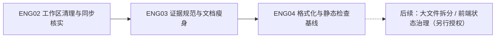

# 工程整固路线图（ENG02–ENG04，2026-11-22 规划）

来源：2026-11-22 主 Agent 只读项目评审的建议 1–4。这一轮不加功能，只降低维护成本：让工作区可知、证据和文档不再膨胀、代码能读能审。三批都**不改变产品行为**，也不改写 Git 历史、不强制推送。

## 基线（2026-11-22 只读实测，HEAD `7b01402a3a7a5f3f20f4c48d10d77cb823c50476` 加工作树）

| 项 | 实测 |
|---|---|
| 工作区 | 7 个已删除（`docs/reports/AUTO01-20261106-review-evidence/*`），6 个已修改（RAWZH01 三份报告、`tests/acceptance/AUTO01-review-actions.test.ts`、`tests/acceptance/rawzh01-builder-browser.mjs`、`tests/rawzh01-ui.test.tsx`），428 个未跟踪条目，共 528 个文件 |
| 同步 | 本地跟踪引用显示 `main` 领先 `origin/main` 2 个提交（`17e244e` AUTOUX01、`7b01402` AUTOUX02），远端未验证；本地分支 `codex/quickux01-delivery` 已合入 `main` |
| 根目录临时目录 | 176 个 `.scratch-*`、37 个 `.test-*`、1 个 `.rn-*`，合计约 4.2GB（已被 `.gitignore` 忽略） |
| 证据体积 | `docs/reports` 跟踪 4,361 个文件、约 174MB；其中非 Markdown 3,660 个、169.7MB；大于 1MB 的 8 个、55.5MB（含 20MiB 的 `fixtures/B03-recheck-browser-20261005/oversize-20MiB-plus1.txt` 和 5 份 6–7MB 的 KB02 导出）。`.git` 打包 74MB |
| 台账 | `docs/status.md` 106.8KB（ENG01 于 11-15 压到 ≤20KB，7 天回涨）；`docs/agent-control.md` 61KB；`docs/acceptance.md` 54KB；`docs/architecture.md` 现行设计与历史叙述混排；README 标“截至 2026-11-09”；`docs/agent-quickstart.md` 仍写“ENG01、RUN01、EVAL01 已完成，当前停止等待用户确认” |
| 代码密度 | `app/server/services` 的 `.ts/.tsx` 中有 1,434 行超过 200 字符（app 605、server 50、services 779），最长 2,979 字符（`services/llm/knowledge-answers.ts`）；无 ESLint/Prettier；部分文件工作区换行为 mixed（索引为 LF） |

## 批次与顺序

| 批次 | 对应建议 | 暂定评分 | 任务卡 |
|---|---|---|---|
| ENG02 | 3 工作区与同步 | 1/0/1/1 = 3，A 标准 | [ENG02](../handoffs/ENG02-20261122-task.md) |
| ENG03 | 2 证据膨胀 + 4 文档 | 0/1/1/1 = 3，A 标准 | [ENG03](../handoffs/ENG03-20261122-task.md) |
| ENG04 | 1 代码格式与静态检查 | 0/2/1/0 = 3，A 标准 | [ENG04](../handoffs/ENG04-20261122-task.md) |

顺序理由：ENG04 的全仓格式化会触及几乎所有产品文件，必须在干净工作区上做，否则会和未提交改动混在一起，所以 ENG02 在前；ENG03 先定证据规范和体积守护，避免 ENG04 及以后的批次继续往仓库里堆原始证据。

## 共同约束

- 不改产品行为；`app/`、`server/`、`services/` 只允许 ENG04 的纯格式化改动。
- 不改写 Git 历史，不强制推送；历史中已有的大文件不因本轮缩小 `.git`。如需改写历史瘦身，作为单独决策交用户，并先评估对 AGENTS.md “不覆盖远程历史”约定的冲突。
- 不直接删除任何证据或用户文件：先移到仓库外归档目录并写清单（路径、字节、SHA-256），确认可再生且用户同意的才删除。
- 不读写正式 `workspace/`、`.env.local`，不调用真实模型或外部资讯源，不占用用户服务端口（4317/5151/5173）。
- 每批按 agent-router 当前规则选择角色和模型，施工与独立验收为不同实例；3 分 A 标准由验收者先审计划。每批 PASS 后汇报并停止，等用户确认再启动下一批。
- 提交与推送由主 Agent 按 AGENTS.md 授权执行，并以远端实际 CI 结果为准。

## 启动前需用户决定

| 编号 | 事项 | 默认建议 |
|---|---|---|
| D1 | 仓库外归档目录 | `E:\AI\Work\AIPM-archive\`（本机，不上传） |
| D2 | 是否改写 Git 历史以缩小 74MB 打包 | 不改写；只阻止今后继续增长 |
| D3 | 代码风格 | 沿用现状：单引号、分号、`printWidth` 120、LF |
| D4 | ENG04 是否同时拆分大文件 | 不拆，只出拆分方案；拆分涉及草稿/提交等数据完整性核心，另开批次按 B 模式 |
| D5 | 是否同意更新 AGENTS.md 入口（现写“再读当前 `docs/batches/Bxx.md`”已过时） | ENG03 起草改动建议，由用户确认后再改 |
