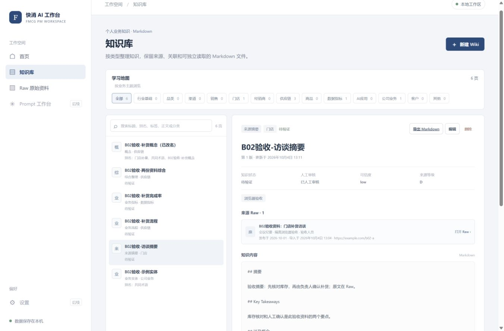

# B02 主 Agent 浏览器实测

日期：2026-10-04（Asia/Shanghai）。通过 CUA 操作真实浏览器，页面为 `http://127.0.0.1:5174/`，API 4318。数据隔离在 `docs/reports/fixtures/B02-browser-20261004/`，所有样本标“B02验收”；没有向正式workspace导入资料。前端版本指纹、对象ID和文件校验在[B02-browser-evidence.json](B02-browser-evidence.json)。最终结论由独立monitor合并。

## 已执行

| 操作 | 实际结果 |
|---|---|
| 首页“新建 Wiki” | 修复异步schema后默认概念模板98字符，含“定义”等节。 |
| 无来源选择“已核实”并保存 | 显示“此状态需要关联有效的 Raw 来源。”，仍为0页，没有错误落盘。 |
| 从页面逐个创建六类型 | Concept、Entity、Source、Business Process、Metric、Synthesis各1页；使用页面提供的类型模板，填写标注为验收的内容，全部保存并读回。 |
| Source 与 Raw | 来源卡显示标题、会议纪要、来源名、验收人员、发布日期2026-10-01、导入时间及URL；点击打开Raw，ID为1aeb7a56-7bb3-4bd2-8700-af9f00a2cda3，完整原文与SHA可读。Source正文仅摘要。 |
| 流程与指标模板 | 流程的AI机会标题在保存正文中标“分析建议”；指标有公式、适用范围、数据来源及待确认说明。 |
| 手动综合 | 实际选择2个Raw，分别填写一致观点、冲突、待确认问题；不称为AI综合。 |
| 关联与歧义 | 概念按标题跳实体，实体按“门店补量”别名返回概念；“共同术语”显示2个候选、不静默选中；不存在页面显示未找到。 |
| 安全显示 | 综合页中的script标签作为正文文本显示，无alert，浏览器错误日志为空。 |
| 搜索 | 依次输入“补货概念”“门店补量”“快消标签”“SKU”“供应链”，对应标题/别名/标签/正文/分类均找到概念页；分类计数仍按全库。精确结果集另由独立HTTP脚本检验。 |
| 编辑/改名 | 概念改名为“B02验收-补货概念（已改名）”，增加标签，revision=2；旧标题自动进入别名；Source原有旧标题链接打开新标题。 |
| 重启 | 隔离服务实际停止后用同目录重新启动；新浏览器首页Raw=2、Wiki=6、本周=8，页面与改名保留。 |
| Markdown下载 | 点击原生“导出 Markdown”链接，download事件取得Downloads实际文件；730字节，独立读取含YAML、Raw ID、正文和Wikilink，与磁盘正式页逐字节相等。归档[下载文件](fixtures/B02-downloaded-source.md)。 |
| 删除引用目标 | 对验收实体点删除，确认面板列出2页入链影响；点击确认后Wiki=5，目标在wiki外回收目录，另外5页字段和正文均保持不变；概念仍revision2且原链接显示未找到。 |
| 刷新与统计 | 删除后刷新，5页、改名与断链保留；后端Raw=2、Wiki=5、本周=7，2条Raw正文哈希与初始相同。 |

## 发现与修复

- UI-01：首页快捷新建早于schema加载，出现空默认模板；builder改为等待schema后初始化，浏览器复测通过。
- UI-02：来源卡仅显示导入日期；增加原发布日期，已实测2026-10-01显示正确。
- UI-03：blob临时链接导出没有浏览器下载完成事件；改为同源原生attachment链接，实测下载文件与原页相等。
- UI-04：编辑正文关联后PUT响应不含links，导致保存成功但关联面板消失。builder改为保存后按固定ID读取完整详情并防止迟到响应覆盖新选页。实测指标revision3保存后立即出现“门店补量”及改名后概念跳转，无需刷新；revision4改回Source链接，保存后立即切Source也保持当前选页。后端文件未改。
- 上述均在Luna施工、Sol独立验收职责内修复，没有同根因两次修复失败，因此未触发模型升级。
- 一次编辑后的测试过早切换页面，发生在保存完成之前；等待完成后选页正常，未将测试同步问题计为产品缺陷。
- 文件对比脚本首次遇到PowerShell序列化将`.750Z`格式化为`.75Z`，按同一时间值归一化后全部存活页面严格相等；没有改产品迁就断言。
- 删除核对完成之后，为复现和回归UI-04明确编辑了指标页revision2–4。删除时“另外5页未改变”的证据对应当时快照，不能用后续主动编辑误判删除破坏。最终指纹和补测见JSON的followup。

## 页面证据

1366×900桌面验收，截图展示删除前的6页验收库；测试后恢复浏览器默认尺寸。

这是B02手动Wiki闭环证据，不代表B03文件导入或B04/B05 AI主线完成。
