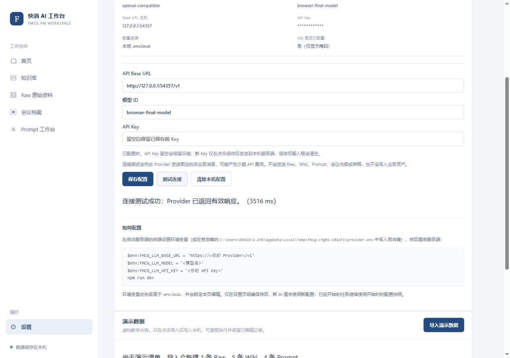
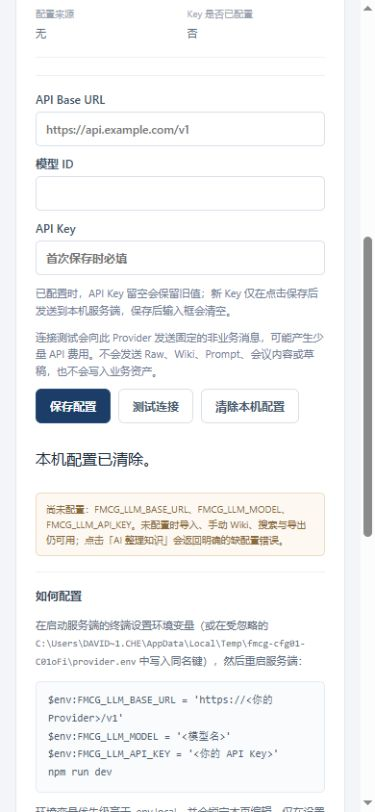

# CFG01 独立最终验收（2026-10-14）

**CFG01本机通用Provider配置入口PASS；Standards/Spec两轴PASS。** 用户指定GPT-6 Luna Max子Agent施工，当前主Agent独立审查实测；不代签全项目及36项真实Provider成功/质量。

本轮关闭FCFG03（序列化/旧配置兼容）、FCFG05（首次加载死锁/迟到隔离）、FCFG07（编码凭证绕过）；独立浏览器发现并回同一Luna修复FCFG08（窄屏备份命令溢出）。第一轮失败及所有历史证据原样保留。

| 门禁 | 结果 | 本次实际证据 |
|---|---|---|
| C01 | PASS | 空配置/首次/保留/替换/清除/同根重启；非LLM行保留、业务备份排除；读写不调用Provider。 证据：http.json |
| C02 | PASS | 旧revision409/外部编辑/并发/env锁/read与rename真实故障；新编码逐字符往返，旧单双引号保留内部反斜杠；非法surrogate拒绝无写。 证据：http.json / edges.json / repair2-probes.json |
| C03 | PASS | 实际adapter→本地fake；成功与401/429/超时/网络/非法/空/回显失败；固定非业务探针、无业务写入。 证据：http.json / browser-lab-final.json |
| C04 | PASS | 原生HTTP确认Host送达，GET/PUT/DELETE/test门禁；编码/嵌套/混合/非法UTF8 URL拒绝；S03/S04六链100/100。 证据：host-calibration.json / http.json / security-final.json / repair2-probes.json |
| C05 | PASS | 桌面1280x900、窄屏390x844；保存后password清空、刷新保留、显式测试、清除真实confirm取消零请求/确认成功、env只读、加载锁定/卸载迟到隔离/失败重试。最终document375/375无横向溢出。 证据：browser.json / desktop.jpg / narrow.jpg / component.json / browser-trace.json |
| C06 | PASS | 新Brief/提取使用新配置，进行中提取保留开始Provider；正常机械链可运行；不签真实Provider语义。 证据：http.json / security-final.json |
| C07 | PASS | 最终冻结后build PASS；完整原样测试字节一致副本215/215。原workspace继承ACL导致rename EPERM，不改ACL/断言、不伪报原地npm test成功。保护与关闭实测通过、文档同步。 证据：tests-writable-copy.json / build-final.log / integrity.json / cleanup.json |

证据均位于本目录，文件前缀CFG01-20261014-。HTTP27/27、edges9/9、R2三组3/3（5个值无损往返/2个surrogate拒绝/10个坏URL）、组件4/4、安全六链100/100、真实浏览器13/13。最终build成功；完整未改动测试在SHA完全一致可写临时副本215/215，原workspace因继承ACL产生EPERM未通过，不将其写成原地npm test PASS。详见[校准](CFG01-20261014-calibration.md)。

冻结84产品/52测试；[完整性](CFG01-20261014-integrity.json)确认1296历史保护文件、正式workspace、实际.env.local未变，旧B04输出恢复；[关闭核验](CFG01-20261014-cleanup.json)确认自有隔离服务/端口关闭，浏览器标签关闭且视口恢复。业务配置与连接测试前后资产SHA不变，fake只收到固定非业务探针。旧任务/new请求使用各自配置，未改业务六链算法与会议来源策略。

[Standards](CFG01-20261014-standards.json)、[Spec](CFG01-20261014-spec.json)、[施工交接](CFG01-20261014-builder.md)、[完整测试](CFG01-20261014-tests-writable-copy.json)、[浏览器](CFG01-20261014-browser.json)、[安全](CFG01-20261014-security-final.json)。

产品现在可在设置填写地址/模型/password Key并明确保存；留空保留已有Key、明确测试、确认清除。环境变量优先且锁住编辑，新AI请求立即读有效配置，旧任务保留快照；加载/保存并不自动调用Provider。项目根.env.local默认服务端私有存储，三LLM字段使用版本化UTF8 base64url无损编码，旧引用格式可读，编码并非加密。

未录入真实凭证、未创建/更改实际.env.local、未选择厂家、未调用外部Provider、未部署。36项真实成功/质量仍BLOCKED，109项汇总73PASS/36BLOCKED保持；Meeting M01-M05与S03/S04既有PASS保留。实际浏览器为本地fake，仅证明机械闭环。下一步由用户在本机设置实际Provider并点击连接测试，再另行授权真实业务验收。

