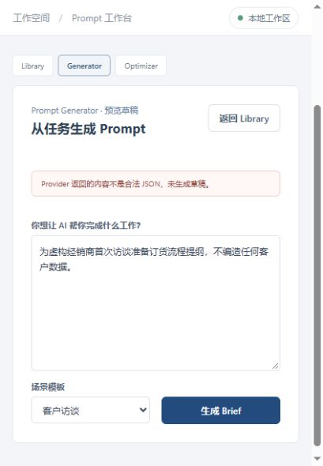

# FULL3 全项目验收审查（2026-10-14）

**整体 FAIL：Standards FAIL（ST-F01/P2），Spec FAIL。当前109项 DOC109 PASS；RUN78 PASS / 3 FAIL / 28 BLOCKED。** Meeting Hub 48项保留原本机阶段PASS。用户已配置真实Provider，本次连接成功不能代签业务成功。

本轮为审查，没有施工、改产品、部署或推进下一批。主Agent负责真实Provider/HTTP/IAB/Spec、数据保护和汇总；独立验收Agent按 coordination 指定 `gpt-6.1-sol/high` 审查Standards及Audit质量。宿主模型由聊天设置决定，仓库文件不能切换宿主模型。

## 真实业务结果

实际配置主机 open.bigmodel.cn，模型 GLM-5.3-Flash。使用真实产品适配器与非流式Chat Completions，共10次外部请求（9次产品请求＋1次诊断重放），未用fake替代这些响应；最多24次的预算未超。全部样本为虚构企业和流程，用户正式Raw/Wiki/Prompt/会议未送出。

| 场景 | 本次实际结果 | 范围和证据 |
|---|---|---|
| 固定消息连接测试 | PASS，约1.8秒 | 无业务写入，证明连通/有效响应 |
| Raw知识提取 | 60秒 LLM_TIMEOUT | 真实任务终态failed；UI说明失败并允许重试，没有提取草稿 |
| 多来源综合 | 90秒 HTTP504 LLM_TIMEOUT | 未获得观点/冲突/待确认结构 |
| Wiki更新/提取入库 | NOT_RUN，前置阻断 | 提取未产生草稿；不能把依赖断言失败算新的产品缺陷 |
| Audit纠错 | PASS，约12.4秒 | 50%纠正为20%，引用Raw原句，保留人工备注；显式隔离accepted后Wiki revision2、Audit resolved，最终磁盘/HTTP/浏览器一致 |
| 自然语言→Brief | FAIL | HTTP502 LLM_SCHEMA_MISMATCH（context）；另次IAB真实调用LLM_INVALID_JSON；均无合法Brief |
| Brief→Prompt | 60秒 LLM_TIMEOUT | 使用明确人工Brief独立补测；改动及已选Wiki进入请求，未选Wiki未发送，无生成预览/保存 |
| 弱Prompt、完整Prompt优化 | 两次均60秒 LLM_TIMEOUT | 无9维检查结果、可审优化版或新版本 |
| 原Brief请求诊断重放 | 60秒 LLM_TIMEOUT | 诊断不能算产品成功；未取得原非法context的实际类型，不猜测响应形状 |
| Lint、Raw完整性 | PASS | Lint只读；四条虚构Raw最终逐字符匹配原输入 |
| 隔离业务备份/恢复 | PASS | 实际产品export/restore实现，16文件16938字节，逐文件一致，排除配置/密钥，源不变 |

原始结果见 [实际HTTP](FULL3-20261014-real-http.json)、[独立生成/优化补测](FULL3-20261014-supplement-real-http.json)、[安全请求追踪](FULL3-20261014-provider-trace.jsonl)、[最终字节核验](FULL3-20261014-final-state.json)、[备份](FULL3-20261014-backup.json)。Trace只记录无鉴权头的虚构请求和状态，不保存Provider原始响应。以上时间是本次样本观测，不是模型整体成功率/性能统计。

## 必须处理的问题

**SP-F01 / P1，当前真实Provider与Brief输出契约未能闭环。** 合法虚构任务经产品HTTP提交，约59.6秒返回502，错误为context不符合契约；IAB单个自然语言输入另次约46.7秒返回非法JSON。预期得到可编辑的任务名/类型及七个字符串字段；实际均没有草稿。对应 A45/R35，R42整体闭环也失败。

`services/prompt-ai/service.ts:37`要求严格字段和字符串，`:92`拒绝非法JSON，`:101`当前提示仅枚举根字段。提示契约缺少完整类型示例是待验证的改进方向，**未证明是唯一根因**；当前拒绝不合规响应并不落草稿的行为正确，不能靠关闭校验或自动正式入库消除问题。[诊断](FULL3-20261014-brief-diagnostic.json)未获得响应形状，不能声称某个数组转换必然修复。

**ST-F01 / P2，损坏提交清单恢复错误不可见。** 在隔离目录放入截断的state/wiki-commits/<UUID>.json，真实listJsonRecords返回0，真实WikiCommitService.reconcile返回空resumed/conflicts；明确get才报读盘错误。`services/storage/files.ts:50–60`直接吞单条异常，`services/wiki/commits.ts:411–433`无法记录该操作，`server/index.ts:136–138`仅报告已读到的冲突。预期应保留文件并明确报告待人工处理。

该文件字节未变；**没有证明正式Wiki丢失、覆盖或重复提交**。其它使用同helper的列表只是相邻风险，未逐一实测。[真实复现](FULL3-20261014-corrupt-recovery.json)、[独立Standards最终补充](FULL3-20261014-standards-supplement.md)均保留。

**BL-F01，真实业务延迟阻断。** 短文提取、生成、弱/完整优化各60秒，综合90秒仍未完成，诊断重放亦超时。连接/Audit成功表明并非完全不可连接；外部服务负载、模型响应策略、网络或请求形态的具体责任尚未定位。矩阵成功/质量项记BLOCKED，不凭超时猜测内部质量，不称其全由产品代码错误导致，也不简单取消超时预算。应测定可用延迟后复验。

## 证据范围和需求裁决

[109项逐行矩阵](FULL3-20261014-spec-matrix.md)：旧73项PASS保持，新增A08/A28/A44/A47/R26五项PASS。A08仅发起/终态可见，A44仅自然语言提交，A47仅选择与实际请求一致；不由这些部分能力推导Brief或生成成功。A28/R26结合旧定位/四决策证据与本轮真实有指导Audit样例、最终字节验证通过；人工反馈已经给出正确20%，不证明自主发现错误或广泛纠错质量。独立 [Audit八项质量复核](FULL3-20261014-standards-quality-audit-reviewer.md) PASS。

A45/R35/R42三行FAIL关联同一Brief及未完成闭环，不是三个独立根因。余28项BLOCKED记录实际超时、前置依赖和覆盖不足，不再称缺配置。100000字符真实提取、六类真实模板覆盖、所有成功链质量、桌面四条真实成功闭环未完成，不签PASS。

[会议48项逐行适用矩阵](FULL3-20261014-meeting-matrix.md)按不变会议模块保留本机PASS，证据来自2026-10-12 M05及2026-10-14 CFG01安全/完整测试；本轮只新看空库导航。飞书登录/远程权限仍NOT_RUN；新Meeting来源继续local_only，不发送Provider，不以真实普通Raw测试绕过会议限制。SEC S03/S04已CLOSED，旧M05未修描述为历史。

[独立Standards](FULL3-20261014-standards.md)确认84产品/52测试与CFG01冻结逐字相同，27个核心及6个会议引用均存在。2026-10-14 CFG01完整215/215测试、build及机械/安全证据按同版本复用，**FULL3未重新跑全部测试/build/解析器/安全专项**。原workspace的npm test受继承ACL影响未通过；215/215是字节相同可写临时副本结果，不冒称原地PASS。保留既有Vite大块警告、其它OS/最低Node未新测的限制。

IAB [本轮浏览器记录](FULL3-20261014-browser.json)在默认窄视口核对失败说明/可重试、自然语言真实失败、最终20%Wiki、空会议和配置掩码/隔离env只读。Audit确认通过隔离HTTP，不能称本轮浏览器点了accepted；桌面及四闭环未新增成功证据。

## 环境、保护与清理

Windows / Node v24.20.0；真实API55633、UI55634，数据根为OS临时隔离目录（[启动元数据](FULL3-20261014-lab.json)）。启动命令为真实 `server/index.ts` / Vite，密钥只读实际配置后在内存与子进程环境使用，未改 `.env.local`。独立脚本保存在 `tests/acceptance/full3-20261014-*`；实际运行及夹具校准见 [校准](FULL3-20261014-calibration.md)。Windows普通写入因ACL拒绝，新增本轮证据通过授权提权写入，未修改ACL。

[保护核验](FULL3-20261014-integrity.json) PASS：84产品/52测试、1360个受保护文件（含正式workspace及历史报告/脚本）不变，无正式workspace新增，实际配置hash不变。隔离最终仅三个人工Wiki（其中一个显式Audit确认更新）和一条人工Prompt，未有未经确认的AI正式资产。16份隔离资产和当时18份本轮报告检查无实际Key；进程日志无Key，最终[报告核验](FULL3-20261014-review-verification.json)检查34份新增报告、实际Key五种明文/编码形式无泄露，全部报告链接存在。

[清理核验](FULL3-20261014-cleanup.json) PASS：本轮自有API/UI进程和端口关闭、自建标签关闭；用户4317/5173继续运行。临时隔离样本及新证据保留复查，不删除用户资产。未修改产品，不将审查视作施工授权。修复及复验建议见 [最小返修卡](FULL3-20261014-repair.md)。

