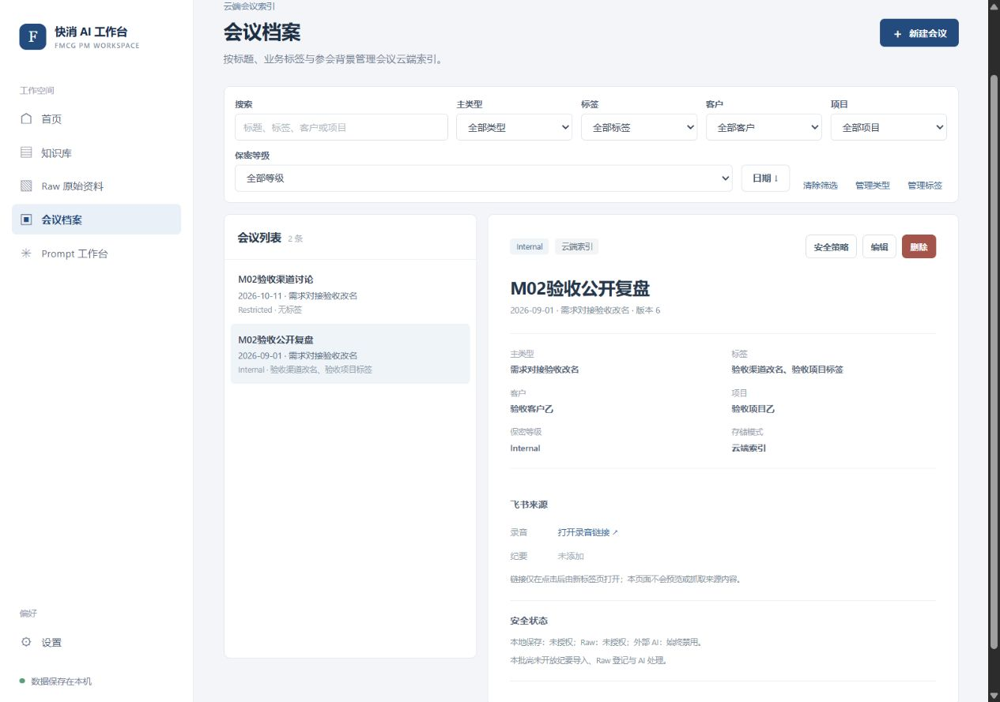
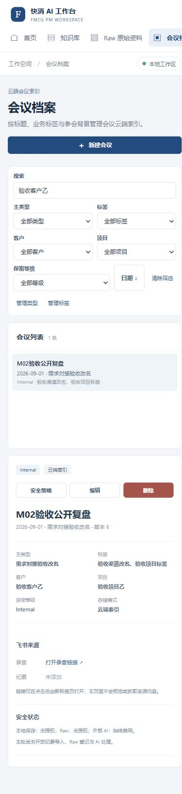

# M02 独立阶段验收

日期2026-10-11，Windows/Node25.2.1。**结论：M02 PASS**。Luna High施工及一轮局部CSS返修；主Agent按用户约定独立验收、写报告，没有修改产品代码。仅 [M02任务卡](../batches/M02.md) 的会议管理界面与云端来源；M03–M05未授权。原全项目S-03/S-04 FAIL与36项真实Provider BLOCKED保留，本报告不改变整体FAIL。

## 最终交付与检查

修改App导航/装配与api类型，新增MeetingPage、meeting.css和一项创建重试单测。后端/依赖/旧测试不变。最终冻结78个产品文件与43个测试支持文件；相对基线仅以上四产品文件和一个新测试，正式workspace2文件、960个受保护文件SHA不变。详见 [冻结](M02-frozen.json)、[完整性](M02-integrity.json)。旧B04两份测试输出已恢复，本轮生成值另存M02-generated文件。

| 独立检查 | 结果 | 实际证据 |
|---|---|---|
| 最终构建/完整测试 | PASS，172/172，无skip | [quality](M02-quality.json)、[build日志](M02-build.log)、[tests日志](M02-tests.log)；tsc8.674秒，Vite2.040秒，测试进程21.606秒 |
| M01关键HTTP/安全回归 | 23/23 PASS | [API回归](M02-api-regression.json)；实际隔离服务和文件，非请求mock |
| React组件＋实际产品HTTP | 12/12 PASS | [组件证据](M02-component.json)；包含双提交、实际冲突、丢响应、读取/删除/策略/目录迟到响应，不称真实浏览器 |
| 原手动/演示/恢复链HTTP | 7/7 PASS | [旧链回归](M02-legacy-http.json)；无Key手动Raw→Wiki/Prompt、同目录重启、损坏/提交故障恢复 |
| 实际浏览器 | 38场景PASS；一缺陷关闭；7显示断言补跑 | [浏览器证据](M02-browser-checks.json)、[补验](M02-browser-policy-rechecks.json)、桌面/窄屏截图 |
| 独立证据交叉核对 | 12/12 PASS | [verification](M02-evidence-verification.json)：排序与UUID、SHA、清字段、重试、取消/删除/重启、隔离与端口关闭 |

build和完整tests在唯一CSS返修后重跑；23 API/12组件/7旧链证据来自同批业务代码，返修只改作用域颜色，业务代码未变。未无谓重复已经通过的服务检查。

## 八项门禁

| ID | 结论与可观察结果 |
|---|---|
| M02-01 | PASS：真实新建→详情→编辑取消/保存→刷新→相同数据根完整API/UI重启→取消/确认删除。取消删除记录字节不变；确认后记录不存在，重启未复活。B01–03/B26–27/B37、V03/V07 |
| M02-02 | PASS：标题/标签名/客户/项目四类搜索，类型/标签/客户/项目/等级五维组合；空结果可清除。日期升降序含同日UUID顺序，refresh后重新进入会议页恢复URL状态。B20–23/B33、C09、V06 |
| M02-03 | PASS：两标签实际落盘；默认类型改名、停用后编辑其它字段、恢复及自定义新增；标签改名/停用/保留/恢复。重启目录未重新seed、ID不变。B06–08、C10、API08–09、V07 |
| M02-04 | PASS：两可选HTTPS和未添加；实际点击录音链接产生独立新标签，href原样、target=_blank、rel=noopener noreferrer。实际HTTP地址拒绝保留输入。没有抓取/播放入口。B04–05/B34、C04 |
| M02-05 | PASS：默认Sensitive/cloud/三false；Public、Internal、Sensitive、Restricted真实操作。未确认本地/Raw分别403，单独确认后保存；升级重新确认并撤Raw。Restricted最少表单/隐藏输入不夹带，升级预览取消未变，确认清字段；切cloud和显式撤权以实际响应显示。7条显示断言另实际重跑/磁盘核对。B09–10/B13–19/B35–36、C11、V04/V12 |
| M02-06 | PASS：服务实际409、400、403、rename EIO500与提交后网络丢响应；输入保留、失败不写盘。原POST提交201丢响应，同输入重试200复用同对象；即时重复提交锁。实际HTTP组件延迟返回不替换其它会议/弹回旧窗口；读/写窗口和卸载世代独立静态核对。B11–12/B15、C01–08、V02/V05 |
| M02-07 | PASS：实际1280×900桌面与390×844窄屏，搜索/详情/链接可达，document无水平溢出；字段有标签且Tab从客户到项目。五个旧导航实际打开，原链7/7回归；三轮会议夹具knowledge/prompts/drafts/state字节不变、Provider调用均0。B24–25/B28–32/B38、C12、V08–09 |
| M02-08 | PASS：最终构建/172tests/23API与文件保护通过，任务/状态/工程说明/README/交接已收尾。自有隔离服务和浏览器标签关闭，九个API/proxy/UI端口实际未监听。无M03路由或按钮。V10–12 |

## 缺陷与验收夹具校准

**F02-01 CLOSED（中）**：真实删除按钮的全局颜色覆盖导致红字红底，并可能影响旧页。实测修前color rgb(154,81,71)、background rgb(164,84,74)；同一Luna把规则限定在会议区域，去掉!important，修后删除/确认按钮均白字。独立reload及桌面/窄屏、最终build/tests复验通过。[浏览器记录](M02-browser-checks.json)，[修前截图](M02-browser-F02-01-before.png)。

验收过程的夹具误判与产品缺陷分开：组件初始选择器没有去装饰“＋”且项目匹配了筛选控件，造成5条无效失败；只校准root夹具，产品未因这5条改动，12条实际HTTP重新跑通过，原 [初始结果](M02-component-fixture-initial.json) 保留。浏览器7个政策显示选择器误用了可访问树插入的空格，初始observed=false不计PASS；原 [记录](M02-browser-selector-initial.json) 保留，使用DOM等级/模式/安全状态另跑7个完整UI政策操作，保存Public、Sensitive取消、Restricted等真实磁盘快照后通过。日期fill只改变native值而未触发本harness的React change，改用真实ArrowDown键并验证2026-09-01落盘，不把首次日期fill计为日期保存成功。

首两轮lab结束flag错误地只看Vite exitCode，信号退出会留下null；原false保留，没有改写原件。root修正夹具判断，最后一轮flag=true，全部三轮shell均exit0，九端口独立探针关闭，详见V11。此项是报告夹具错误，不是产品故障。未进行无依据的模型升级。

## 持久化、隔离与边界

实际浏览器数据根`C:\Users\80593\AppData\Local\Temp\fmcg-m02-browser-KygodI`；第一轮UI57879/API57861/proxy57878，同根重启UI62640/API62633/proxy62639，显示补验UI62216/API62207/proxy62215。均只监听127.0.0.1。日期同日排序用三条真实记录核对UUID，第三条确认删除；补验对象也已删除，原两条记录与目录字节不变。

[首次服务证据](M02-browser-lab-first-final.json)、[重启证据](M02-browser-lab-second-final.json)、[最终服务证据](M02-browser-lab-final.json)均记录旧资产SHA和Provider0；[重启前](M02-browser-before-restart.json)/[重启后](M02-browser-after-restart.json)/[补验后](M02-browser-after-recheck.json)记录实际API与磁盘值。正式用户数据没有被夹具写入。

本批没有Provider需求；本地trap零调用并非真实AI质量验收。原36项真实Provider仍BLOCKED。会议正文导入、本地副本、Raw来源门禁、AI/Wiki关联、跨平台/最低Node、用户极限数据量为NOT_RUN/后续范围。八类型/目录容量等服务边界沿M01接口，本次23 API覆盖核心约束，不宣称本次重跑M01所有备份/18项专项。服务文件SHA未变，可保留其既有历史证据。子Agenttoken计量不可得。

可以在用户另行授权后进入M03；本轮停在M02。交接见 [M02-interface](../meeting-hub/M02-interface.md)。

