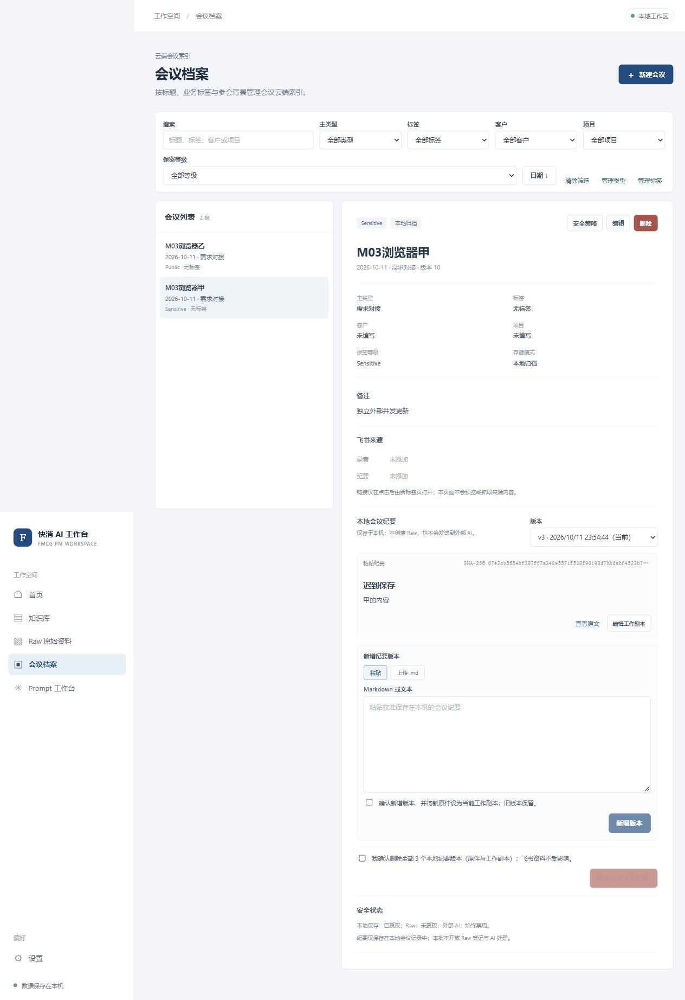
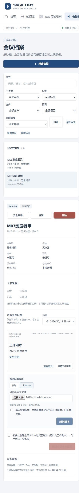

# M03 独立阶段验收

2026-10-12（本机时间）。结论：**M03 PASS**。GPT-6 Luna High施工及全部返修，主Agent独立检查最终冻结产品；主Agent只编写任务/隔离验收脚本及交付文档，没有修改产品或单测。用户授权范围仅M03，M04/M05未开始。原全项目S-03/S-04 **FAIL**、真实Provider36项 **BLOCKED**继续保留，本阶段PASS不改变整体结论。

交付：获授权的Markdown/粘贴归档、不可改写原件、可编辑当前工作副本、历史版本、安全阅读、明确清空/档案删除、策略副本保护以及实际全版本备份恢复。[任务卡](../batches/M03.md)、[最终接口](../meeting-hub/M03-interface.md)、[返修卡](M03-repair-01.md)。

## 版本、范围和独立性

基线[M03-baseline.json](M03-baseline.json)，首版与失败证据保留`M03-initial-*`；最终冻结[M03-frozen.json](M03-frozen.json)。相对基线11个已有产品文件变更：Meeting服务/策略/类型、会议HTTP及最小服务装配、页面/API/局部CSS、依赖锁定及备份验证；新增`app/MeetingMinutes.tsx`。仅新增精确react-markdown10.1.0及所需传递依赖，增加MIT许可证文件。旧`tests/meeting-ui.test.tsx`只补真实详情夹具；新增纪要和大备份定向测试。备份脚本修复及旧测试夹具例外均先在任务卡/返修卡明确，未削弱原安全断言。

最终79产品文件、45单测/支持文件在验收期间未变；正式workspace2文件、1018个受保护历史/原始需求/旧脚本等文件SHA不变。[完整性](M03-integrity.json)。完整测试覆盖的两份旧B04报告已恢复，本次结果另存`M03-generated-*`。历史报告不重写；最终文档更新限状态、README、架构、本卡及Meeting交接。平台未提供子Agent token实数，记不可得。

## 新实测证据

| 检查 | 实际结果 | 证据 |
|---|---|---|
| 最终完整构建 | PASS；tsc6.862秒、Vite2.214秒 | [质量记录](M03-quality.json)、[日志](M03-build.log) |
| 最终完整测试 | 177/177；fail/skipped/cancelled均0；Node时长19.590秒 | [质量记录](M03-quality.json)、[测试日志](M03-tests.log) |
| M03实际产品HTTP/磁盘 | 21/21，26.365秒 | [HTTP](M03-http.json) |
| M01/M02基础接口回归 | 23/23，2.873秒，最终版本重跑 | [基础HTTP](M03-api-regression.json) |
| jsdom接真实HTTP组件 | 18/18，3.733秒，最终版本重跑；不冒称浏览器 | [组件](M03-component.json) |
| 旧手动资产/教学链路 | 7/7，首版实际HTTP；后续改动未触及该旧链 | [旧HTTP](M03-legacy-http.json) |
| 实际CLI新旧备份恢复 | 5/5，8.644秒，最终版本 | [备份](M03-backup.json) |
| 实际IAB浏览器 | 37条有效PASS；5条无效早期采样另保留；1条真实缺陷关闭 | [原始观察](M03-browser-observations.json)、[校准](M03-browser-calibration.json) |
| 证据交叉核对 | 16/16，文件/磁盘/观测/服务/端口/截图实际核对 | [核对](M03-evidence-verify.json) |

质量脚本使用package.json等价命令：`node tests/acceptance/m03-quality.mjs`执行tsc、Vite和完整Node测试；其余独立脚本为`m03-http.mjs`、`m03-api-regression.mjs`、`m03-component.mjs`、`m03-legacy-http.mjs`、`m03-backup.mjs`。隔离临时数据、自有API/Provider陷阱/浏览器代理，不连接正式数据。fake仅测意外Provider调用，不代签真实AI。

最终备份实际使用首轮HTTP已生成的合法大会议夹具（source见JSON），由最终产品/CLI执行恢复；不误称它来自最终HTTP的另一个临时根。22文件、45,399,486字节归档恢复后逐字节SHA一致，产品服务读回所有原件/工作副本/active；没有meetings的旧v1归档、9种恶意会议归档、根/嵌套junction、非空目标/源保护均通过。

## 门禁映射

| ID | 结论 | 独立依据 |
|---|---|---|
| M03-01 四级权限/前置拒绝/竞态/隔离 | PASS | H01/H02/H15/H21；实际流式上传挂起后撤权，最终拒绝且正文未提交；组件与两轮浏览器Provider为0 |
| M03-02 原件/工作副本/历史/重启 | PASS | H03–H06/H19；浏览器B04a–B11/B26–B28；BOM/CRLF/尾空格上传逐字符一致、原件SHA不变、旧工作副本只读，同目录重启全文件SHA相同 |
| M03-03 格式/大小/损坏/失败/幂等 | PASS | H07–H09/H14/H16–H20；实际2MiB/500000字符/32MiB限制、8种损坏保留、rename EIO、200/409并发、浏览器丢提交响应同ID重试只形成一个版本 |
| M03-04 安全Markdown/外链 | PASS | B03/B04a/B10/B17a；HTML/脚本/data不执行，渲染无img/script，陷阱无自动图片请求；用户点击HTTPS实际打开Example Domain新标签 |
| M03-05 删除/副本保护 | PASS | H10–H12；B12/B29–B35；2个版本阻塞cloud并显示真实计数，取消保留，清空后可撤权转cloud，旧请求墓碑不复活，带正文档案删除额外确认 |
| M03-06 真实UI/失败输入/迟到/旧页 | PASS | 18项真实HTTP组件；B14–B28/B36；1280×900及390×844无横向溢出，实际EIO/409输入保留，切会迟到不串页、刷新重启、六导航可用 |
| M03-07 全版本备份/摘要/资产隔离 | PASS | 实际CLI5/5、H13/H21、两轮浏览器旧根SHA不变；列表无正文/内部账本，备份大记录实际恢复成功 |
| M03-08 构建/保护/交接/范围 | PASS | 完整177测试和build、冻结SHA、正式数据2文件/受保护1018文件、16项证据核对及本报告/交接；不代签后续批次和整体FAIL |

H编号对应最终HTTP JSON检查项；B编号对应浏览器原始观察。

## 发现与关闭

| 缺陷 | 首次实际失败 | 同一Luna修复及独立闭环 |
|---|---|---|
| F03-01 P2 | 有副本撤本地授权先返回403，无法表达副本冲突 | 将副本检查前置，H10最终409及计数PASS；四级规则保持 |
| F03-02 P2验证阻断 | 旧UI模拟详情缺已有imports字段，首版完整175项174通过 | 补真实详情/列表夹具，保持丢响应同ID双POST断言；最终177通过。实际产品详情不是该缺陷 |
| F03-03 P1 | 合法45MB归档导出后恢复base64正则栈溢出 | 线性字母/填充验证，保留规范编码/长度/SHA/路径限额；独立实际大归档恢复与9恶意归档PASS |
| F03-04 P2 | 策略弹窗仍称未交付纪要，副本错误缺真实数量 | 修正能力说明并仅追加受控整数计数；B12/B13真实界面及B33a清空后转cloudPASS |

四项 **CLOSED**。首版FAIL证据保留，不将其改为PASS。浏览器43条原始记录中，5条无效观测分别是未勾独立确认、错误比较textarea LF与CRLF、弹出页创建前采样、清空/策略提交完成前采样（最后一条原PASS也剔除）；都有明确重测记录。真实F03-04失败单列关闭，剩余37条有效记录均通过。[校准依据](M03-browser-calibration.json)。截图原文件扩展名png但浏览器实际返回JPEG，保留原件并复制正确jpg扩展名；核对脚本初始格式假设已纠正，不是产品缺陷。

## 数据与环境收尾

真实写失败前后会议所有文件SHA一致；重启前后全部会议文件SHA一致。最终浏览器A已清空全部3版本、保留无正文删除墓碑并转cloud撤权；确认删除B后B文件缺失、A字节未变。[最终离线磁盘](M03-browser-final-disk.json)。服务关闭前最后一次在线快照受本机sandbox localhost EACCES限制，未补签不存在的在线结果；最终使用保留的浏览器完成观察、HTTP服务trace和关闭后磁盘检查交叉核对。

两轮同一隔离数据根的API/代理/UI及Provider陷阱已关闭，6个端口实际ECONNREFUSED；临时浏览器标签已关闭，视口覆盖已重置。两轮会议操作Provider0、knowledge/prompts/drafts/state不变。[第一轮收尾](M03-browser-first-lab-final.json)、[第二轮收尾](M03-browser-lab-final.json)。日志中的socket hang up是有意丢提交响应测试，不伪装成产品成功。Root大备份复验已成功，施工方受限环境的EPERM不据此标实际BLOCKED。

仅Windows/Node25.2.1和IAB已实测；未部署、未签最低Node/其它OS、真实AI成功/质量或M04 Raw来源处理限制。文件符号链接创建能力受Windows权限限制，junction拒绝已测。现有Vite大bundle警告保留；本批无性能承诺。当前可以交付M03；后续施工需新的用户授权。

## 界面实测截图

桌面1280×900与窄屏390×844为实际浏览器视口；全页图不含滚动条，图像宽1264/375，与视口值分别记录。两张已人工查看。

