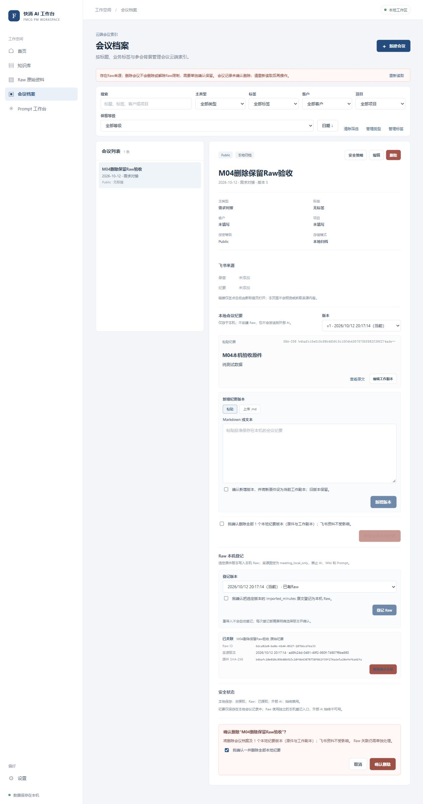

# M04 独立审查：FAIL

日期：2026-10-12，Asia/Shanghai。用户已澄清本次交付是M04，施工模型据用户说明为glm5.1-flash；本轮审查当前工作区文件，不核验外部Harness实际模型。**M04 FAIL，8项问题OPEN（4 P1、4 P2），不能推进M05。** 构建和183项自动化测试通过不抵消实测失败。原S-03/S-04 FAIL、真实Provider36项BLOCKED继续保留。

范围依据：[批次边界M04](../meeting-hub/batch-boundaries.md)、[增量方案§3/6/7](../meeting-hub/incremental-plan.md)、[原需求](../meeting-hub/requirements.md)。本轮应用code-review技能，两个只读审查子Agent分别评估Standards和Spec，主Agent独立运行真实HTTP/磁盘、组件和浏览器验证。只写验收脚本、报告/返修卡和状态文档，未改产品或单测，未派施工Agent修复。

## 比较与冻结

[本轮基线](M04-review-20261012-baseline.json)冻结82产品文件、47测试/支持文件；与旧M03-frozen.json相比18个已有产品文件、3个已有测试文件SHA改变，新增3个产品文件和2个测试文件。变更涵盖Meeting/Raw桥、共享来源限制、Wiki/提取/Audit/Prompt服务入口、HTTP及页面。无Git和旧源码副本，旧SHA可证明哪些文件改变，不能提供完整行diff或归因所有行的引入时间。旧M03 PASS只证明当时冻结版本，不能复用于此版本。

本轮开始时正式workspace已有3文件，与旧M03当时2文件不同；**只对本轮开始的3文件做保护检查**，不把用户此前变化当本轮缺陷。[最终完整性](M04-review-20261012-integrity.json)：82产品、47测试、3正式数据、1070受保护历史/旧脚本等文件均未变。完整测试覆盖的两份旧B04报告已备份恢复，本次输出另存。本轮不改原M03报告/冻结/观察等历史证据。

## 已确认缺陷

| ID/严重度 | 触发、实际结果与影响 | 位置/证据 |
|---|---|---|
| F04-01 P1 | 登记当前纪要为Raw后，清空返回200、再导入返回201；随后的详情读取均409 CORRUPT_MEETING。两操作改变active却保留旧raw_source_id，与新校验投影矛盾；保存未检查该不变量 | `services/meeting/store.ts:313,343,140,225`；HTTP H17/H21 |
| F04-02 P1 | 启动恢复prepared知识提交，其快照指向真实Meeting Raw且摘要匹配，仍写出正式Wiki。即时HTTP读200，关闭服务后manifest为completed。来源检查被放在“不存在/摘要不匹配”分支内，合法受限来源跳过检查 | `services/wiki/knowledge-workflows.ts:245–246,260`；HTTP H19、证据核对。旧目标来源在确认/execute阶段漏查另有静态证据，返修须同时覆盖 |
| F04-03 P1 | 恢复Wiki的Raw来源缺失时，Prompt生成仍调用Provider；本地陷阱收到所选Wiki的测试正文，上游故意500后HTTP502。失败已发生在发送阶段；来源缺失不能当允许处理 | `services/meeting/source-policy.ts:47`、`services/wiki/store.ts:156–157`、`services/prompt-ai/service.ts:110`；HTTP H12实际1次Provider调用、contextReachedTrap=true |
| F04-04 P1 | 合法200字符会议标题登记Raw，派生raw_title变为205字符，pending先写盘；重读因200上限报损坏，之后详情409。合法输入导致不可读记录 | `services/meeting/store.ts:373,86,383`；HTTP H18 |
| F04-05 P2 | 同一会议首次导入成功后，Raw确认框/按钮仍禁用；已有纪要保存工作副本后，Raw表单提交旧revision（3而非4），登记409。effect只跟meeting_id变化 | `app/MeetingRawLinks.tsx:28–37`；实际HTTP组件C01/C02 |
| F04-06 P2 | 页面删除含Raw会议，没有保留Raw确认控件，不提交confirmRawReferences，服务端409 MEETING_HAS_REFERENCES。取消/重读不能补齐该操作；解除关联后服务仍要求确认 | `app/pages/MeetingPage.tsx:54`、`services/meeting/store.ts:490–492`；组件C03、真实浏览器B01；H15带正确字段的API删除成功并保留Raw限制 |
| F04-07 P2 | Raw实际rename EIO后保留failed记录，原请求baseRevision=4、刷新后会议revision=5。页面“同请求重试”使用当前revision，指纹包含旧revision，必409 IDEMPOTENCY_CONFLICT，登记无法恢复 | `services/meeting/store.ts:357–360`、`app/MeetingRawLinks.tsx:75–80`；HTTP H16、组件C04；pending重试被activeLinks禁用另为静态追加检查 |
| F04-08 P2 | 普通Raw入口选择旧meeting分类、没有新增origin，仍403 MEETING_RAW_FORBIDDEN。旧页面还提供该分类，破坏原普通会议资料创建/重新导入；新来源限制不应等同分类 | `server/validation.ts:13`、`app/pages/RawPage.tsx:213`；HTTP H07；增量方案明确要求无新origin的旧资料兼容 |

全部8项有主Agent实际复现依据，互相重叠的触发合并为同一缺陷。F04-02中的旧目标来源确认、F04-07中的pending按钮为同根因附近的**静态补充**，不冒称额外实测。F04-03的测试正文只传给自建localhost陷阱，未调用真实外部Provider或使用正式资料。

## 两个审查轴

**Standards：FAIL。** F04-02/03违背统一来源检查和缺失来源拒绝处理；F04-04违背完整有效提交及失败保留可用旧内容；F04-08违背旧普通Raw兼容。类型重复/代码样式等启发式未作为缺陷。旧服务多处增加检查本身属于M04允许范围。

**Spec：FAIL。** F04-01破坏重导入/清空与持久化；F04-02/03破坏恢复/Prompt的来源边界；F04-05/06/07使真实登记、删除、重试闭环不能完成。Public/Internal授权后正常登记原件、Sensitive/Restricted拒绝、一般提取/混合综合/手动Wiki/已知受限Wiki的Prompt拒绝路径部分成立，不能覆盖漏查路径。

## 实测与门禁

| 检查 | 本轮实际结果 | 证据 |
|---|---|---|
| 完整build | PASS；tsc进程6.873秒、Vite进程2.078秒 | [质量记录](M04-review-20261012-quality.json)、[build日志](M04-review-20261012-build.log) |
| 完整tests | 183/183，无跳过/取消；Node19.432秒，进程19.584秒 | [测试日志](M04-review-20261012-tests.log) |
| 真实产品HTTP/磁盘/重启 | 21项：14 PASS / 7 FAIL，1.648秒；7失败对应6个独立问题，H17/H21同根因 | [HTTP](M04-review-20261012-http.json) |
| React接真实HTTP | 6项：2 PASS / 4 FAIL，**不等同浏览器** | [组件](M04-review-20261012-component.json) |
| 实际IAB浏览器 | B01 FAIL，确认缺Raw控件/真实DELETE409/档案保留 | [观察](M04-review-20261012-browser.json)、[截图](M04-review-20261012-browser-delete.jpg)、[trace及关闭](M04-review-20261012-browser-lab-final.json) |
| 证据完整性/关闭核对 | 6/6核对成立；这是证据可信性，**不是产品PASS** | [核对](M04-review-20261012-evidence.json) |

独立命令为`node tests/acceptance/m04-review-quality.mjs`（package等价build/tests）、`node tests/acceptance/m04-review-http.mjs`、`node --import tsx --import ./tests/support/css-stub.mjs tests/acceptance/m04-review-component.mjs`。脚本与夹具均新建于m04-review范围，旧脚本未改。首轮H08/H15使用了错误的旧提取路径，404属于验收脚本错误，已纠正为`/api/raw/:id/extract`并实际重测通过；初始JSON另留[M04-review-20261012-http-initial.json](M04-review-20261012-http-initial.json)，不将其错误计作产品缺陷。最初上下文探针只发送了标题段，最终明确匹配测试正文并观察到传出；保留原始差异，不声称最初已发出完整测试正文。

H19的恢复清单由独立脚本在隔离目录模拟既有/备份恢复的prepared提交，包含真实合法Meeting Raw和匹配SHA；不是普通HTTP可提交任意清单的声明。即时样本为committing，后续关闭后核对completed并实际存在Wiki，阶段区分记录，未更改即时证据。

| M04原完成条件 | 结论 |
|---|---|
| 1 原件、双向来源、正常Public/Internal登记 | 部分PASS：H03/H04正文与SHA完全一致；F04-04/F04-05使正常合法输入/UI仍失败，整项FAIL |
| 2 幂等、部分失败、恢复、重查策略 | FAIL：正常相同请求H05通过，但F04-07原请求刷新重试失败；全部中断/并发策略组合本轮未签通过 |
| 3 四级权限/伪造来源/固定local_only | 已测直接路径PASS：H01/H02/H06，无新origin普通meeting回归另归条件6；不是完整安全保证 |
| 4 全部旧入口与恢复不绕过/零传输写入 | FAIL：H19正式Wiki写入、H12 Provider1次；Audit/提取执行时竞态等剩余组合未全部本轮执行，不签整体通过 |
| 5 编辑/重导入/清空/解除/删除保持来源 | FAIL：F04-01/F04-06；解除取消/确认、正确API删除保留限制部分成立 |
| 6 普通旧资料兼容/保留原问题 | FAIL：F04-08；未改签S-03/S-04或真实Provider。183旧/新单测通过不证明全部旧链兼容 |

本轮已发现足以判FAIL的确定问题，未重复扩展完整新旧备份CLI、全部跨入口恢复、窄屏/所有实际浏览器操作；这些记为本轮NOT_RUN，旧M03证据不代签M04。Windows/Node25.2.1、IAB已测，其它平台/最低Node/真实Provider成功质量未测。平台未暴露子Agent token实数，记不可得。

## 收尾与下一步

所有自建HTTP/组件服务、Provider陷阱和浏览器API/代理/UI已关闭；浏览器三端口实际ECONNREFUSED，临时标签关闭，无视口覆盖。浏览器测试显式登记预期增加1个Raw，旧knowledge其余文件、prompts/drafts/state保持不变；不能把这段预期Raw新增描述为“零knowledge写入”。组件Provider0；HTTP缺失来源探针Provider1是本轮失败证据，不能标零调用。

[最小返修卡](M04-review-20261012-repair.md)列出8项整改和回归要求。本轮只审查，不自动发起GLM/Luna施工，不部署、不推进M05。修复后应重新冻结并复验本卡失败场景及被影响的来源/旧链回归。

